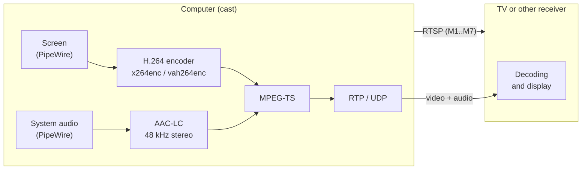
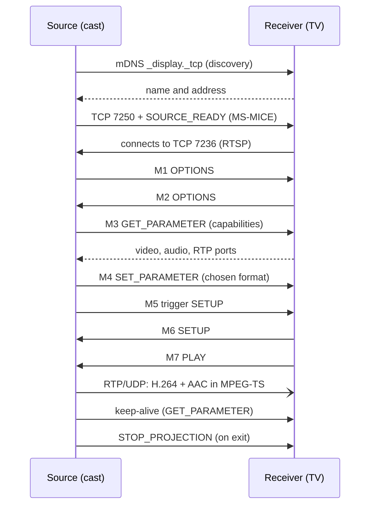

# miracast

**English** | [Português](README.md)

Command-line **Miracast (Wi-Fi Display)** source and sink for Linux.

- **`cast`** sends the computer's screen and audio to a TV or another Miracast receiver.
- **`sink`** receives a Miracast stream and displays it on the computer.
- **`scan`** lists the receivers nearby.

Two transports are supported:

| Transport | Needs | When to use |
|---|---|---|
| **Miracast over Infrastructure (MS-MICE)** | just a regular IP network (Wi-Fi or Ethernet); the receiver must implement MS-MICE | the simplest path: no special Wi-Fi hardware |
| **Wi-Fi Direct (P2P)** | an adapter whose driver has the `P2P-client`/`P2P-GO` modes, `wpa_supplicant` with P2P, and root | the "classic" Miracast, for TVs without MS-MICE |

`cast` tries the network first (automatic discovery over mDNS) and falls back to Wi-Fi Direct if it does not find the receiver.

> **Project status.** The network mode was tested end to end with an LG webOS TV (50NANO75SPA): screen, audio and automatic discovery. Wi-Fi Direct is implemented but **has not been tested against real hardware**, because the development adapter has no P2P modes. The implementation follows the public specifications and is **not certified by the Wi-Fi Alliance**.

## Features

- Complete Wi-Fi Display RTSP session: messages M1 to M7, keep-alive, IDR request and teardown.
- H.264 video (CBP/CHP) in MPEG-TS over RTP; negotiates the highest resolution and frame rate both sides support, from 640x480p60 up to 1920x1080p60.
- System audio as AAC-LC 48 kHz stereo, when the receiver supports it.
- Screen capture on Wayland through the `org.gnome.Mutter.ScreenCast` API (niri, GNOME) with PipeWire, without a portal dialog; on X11 it uses `ximagesrc`.
- Configurable encoder, bitrate and buffers, including a GPU encoder (`vah264enc`).
- Automatic receiver discovery over mDNS (`_display._tcp`).

## Requirements

- Linux, a C++17 compiler and CMake 3.16 or newer
- GStreamer (tested with 1.28): *base*, *good*, *bad*, *ugly* and *libav* plugins
- `gst-plugin-va` (GPU and DMA-BUF frame import, needed on compositors such as niri)
- PipeWire (screen and audio capture)
- Wi-Fi Direct only: `wpa_supplicant` with P2P and Wi-Fi Display, `iproute2`, `dnsmasq` and a DHCP client (`dhcpcd`, `dhclient` or `udhcpc`)

Installing the dependencies:

```sh
# Arch Linux
sudo pacman -S --needed base-devel cmake pkgconf gstreamer gst-plugins-base \
    gst-plugins-good gst-plugins-bad gst-plugins-ugly gst-libav gst-plugin-va \
    gst-plugin-pipewire pipewire dnsmasq

# Debian / Ubuntu
sudo apt install build-essential cmake pkg-config libgstreamer1.0-dev \
    libgstreamer-plugins-base1.0-dev libglib2.0-dev gstreamer1.0-plugins-base \
    gstreamer1.0-plugins-good gstreamer1.0-plugins-bad gstreamer1.0-plugins-ugly \
    gstreamer1.0-libav gstreamer1.0-pipewire dnsmasq iproute2
```

## Building

```sh
git clone https://github.com/ensismoebius/Miracast miracast
cd miracast
cmake -S . -B build -DCMAKE_BUILD_TYPE=Release
cmake --build build -j"$(nproc)"
ctest --test-dir build --output-on-failure   # unit and in-memory integration tests
```

The binary is `build/miracast`.

## Installing

```sh
sudo cmake --install build                        # /usr/local
sudo cmake --install build --prefix /usr          # or another prefix
```

This installs the binary in `bin/`, the man page in `share/man/man1/`, the license and the READMEs in `share/doc/`, and the systemd unit `miracast-sink.service` in `lib/systemd/system/`. To uninstall, delete the files listed in `build/install_manifest.txt`.

After installing, read the full documentation with `man miracast`.

## Packages (Arch, Debian, Ubuntu, Fedora)

The `packaging/build.sh` script builds native packages from the working tree and puts them in `dist/`:

```sh
packaging/build.sh arch       # .pkg.tar.zst
packaging/build.sh debian     # .deb  (Debian stable)
packaging/build.sh ubuntu     # .deb  (Ubuntu 24.04)
packaging/build.sh fedora     # .rpm and .src.rpm
packaging/build.sh all        # everything
```

If the host is the target distribution (or a derivative), the package is built locally; otherwise the script uses a Docker container (`--docker` forces it, `--native` avoids it). The packaging files are `packaging/arch/PKGBUILD`, `packaging/debian/` and `packaging/rpm/miracast.spec`. Once built:

```sh
sudo pacman -U dist/miracast-1.0.0-*.pkg.tar.zst    # Arch
sudo apt install ./dist/miracast_1.0.0_*_amd64.deb # Debian / Ubuntu
sudo dnf install dist/miracast-1.0.0-*.x86_64.rpm  # Fedora
```

On Fedora, the `x264enc` encoder comes from RPM Fusion (`gstreamer1-plugins-ugly`); without it use `--encoder vah264enc`.

Ready-made packages are attached to each [GitHub release](https://github.com/ensismoebius/Miracast/releases).

## Usage

### Casting the screen to a TV (network)

```sh
miracast scan --no-p2p        # list the receivers on the network
miracast cast                 # use the only receiver found
miracast cast my-tv           # pick by name (shown by scan)
miracast cast 192.168.0.3     # or by IP address, without discovery
```

The TV may ask for confirmation on screen the first time you connect. Stop with `Ctrl+C`.

Example tuned for quality and latency:

```sh
miracast cast my-tv --output eDP-1 --encoder vah264enc \
    --max-width 1280 --max-fps 30 --bitrate 6000 --buffer-ms 60
```

### Casting over Wi-Fi Direct

Needs root and a P2P-capable adapter:

```sh
sudo miracast scan -i wlan0
sudo miracast cast "TV name" --p2p -i wlan0
```

If the adapter does not support P2P, the program says so and suggests the network mode. Check with `iw phy | grep -A8 "interface modes"` and look for `P2P-client` and `P2P-GO`.

### Receiving a stream (`sink`)

```sh
miracast sink --no-p2p --listen 0.0.0.0     # over the local network
sudo miracast sink -i wlan0                 # over Wi-Fi Direct (becomes the group owner)
```

There is also a `miracast-sink.service` unit to keep the receiver running as a service (`sudo systemctl enable --now miracast-sink`).

### Main options

| Option | Description |
|---|---|
| `--output NAME` | monitor to share (e.g. `eDP-1`) |
| `--encoder NAME` | `x264enc` (CPU, default), `vah264enc` (GPU) or another GStreamer H.264 encoder |
| `--encoder-opts "k=v ..."` | extra encoder properties |
| `--bitrate KBPS` | video bitrate (default 8000) |
| `--max-width PX`, `--max-fps N` | resolution and frame-rate limits (default 1920 and 60) |
| `--buffer-ms N` | queue between capture and encoder; `0` disables it (default 100) |
| `--jitter-ms N` | (sink) receive buffer (default 40) |
| `--no-audio`, `--audio-source F` | turn audio off / use another audio source |
| `--capture F`, `--test-pattern` | custom capture / test pattern |
| `--mice`, `--p2p`, `--no-p2p`, `--host IP` | pick the transport manually |
| `-v`, `-vv` | more logging / protocol trace |

The full list is in `miracast --help` and `man miracast`.

### Exit codes

Follows `sysexits.h`: `0` success, `64` usage error, `68` receiver not found, `69` service unavailable (no P2P, connection refused), `70` protocol error, `71` operating-system error, `75` temporary failure.

## Troubleshooting

| Symptom | Likely cause |
|---|---|
| `this interface cannot do Wi-Fi Direct` | the driver exposes no P2P modes; use the network mode or another adapter |
| `no element "udpsrc"` / `"avenc_aac"` | `gst-plugins-good` / `gst-libav` are missing |
| `stream error: no more input formats` when capturing | the compositor only delivers DMA-BUF; install `gst-plugin-va` |
| the TV does not show up in `scan` | the receiver may not support MS-MICE (no TCP port 7250); try Wi-Fi Direct |
| connects but no picture arrives | this computer's firewall must allow incoming TCP port 7236 |
| delayed picture | lower `--buffer-ms`, `--bitrate` and the resolution; use `--encoder vah264enc` |

## How it works



Sequence of a session over the network (MS-MICE); with Wi-Fi Direct there is no mDNS or MS-MICE: the source opens the RTSP connection to the receiver directly and the rest of the session is the same:



- `src/rtsp_peer`, `sink_session`, `source_session`: protocol state machines, independent of network and media (hence testable in memory).
- `src/mice_protocol`, `mdns_discovery`, `dns_packet`: Miracast over the network and discovery.
- `src/p2p_link`, `wpa_ctrl`, `group_network`: Wi-Fi Direct through `wpa_supplicant`.
- `src/gst_source_media`, `gst_sink_media`, `screen_capture`, `encoder_chain`: GStreamer media and screen capture.

## Development

The code follows the Linux kernel style (`.clang-format`, 8-column tabs), has an SPDX header in every file, one type per file and documentation on every function. To format:

```sh
clang-format -i src/*.cpp src/*.hpp tests/*
```

## Known limitations

- No encryption (HDCP, DTLS) or MS-MICE PIN entry.
- Audio only flows from source to receiver, as stereo AAC-LC.
- Wi-Fi Direct has not been tested on real hardware.

## References

- Wi-Fi Display Technical Specification v2.1 (Wi-Fi Alliance)
- [MS-MICE]: Miracast over Infrastructure Connection Establishment Protocol (Microsoft)

## License

GPL-2.0-or-later. See the [LICENSE](LICENSE) file.
